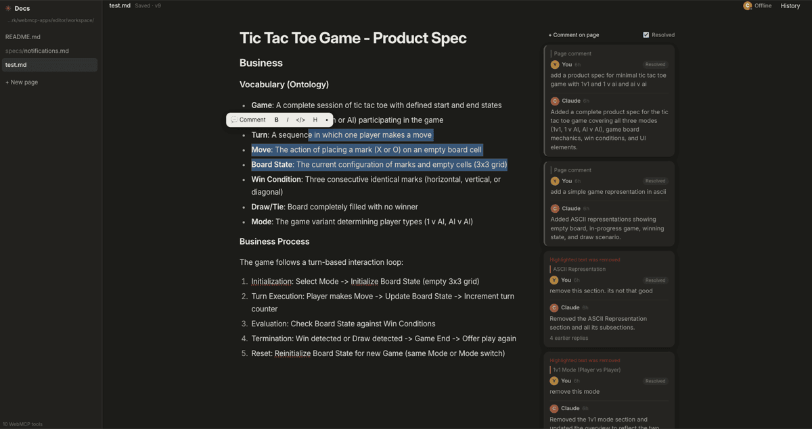

# webmcp-apps

**Let your local Claude Code drive a web page. No backend, no API keys, no agent SDK.**

Each page registers tools with [WebMCP](https://webmachinelearning.github.io/webmcp/)
(`document.modelContext.registerTool(...)`), and Claude Code calls them through a small bridge.

```
claude ──MCP──► webmcp-bridge ──CDP──► Chrome tab ──► document.modelContext tools
```

## Quick start

You need Node 22+, Chrome and [Claude Code](https://claude.com/claude-code). In the folder you run
`claude` from, add the bridge once:

```bash
claude mcp add webmcp -- npx -y @smarchone/webmcp-bridge
```

Then ask Claude to open one of the live apps:

```bash
claude "Open https://smarchone.github.io/webmcp-apps/dino/ with the webmcp tools and play one game"
claude "Open https://smarchone.github.io/webmcp-apps/maps/ with the webmcp tools and plot the IITs in India"
```

Chrome opens the page and Claude starts using its tools. Each page teaches Claude what to do through
its own tools, so there's nothing else to install. For better results, each page's install box has an
Advanced section with a detailed prompt and a slash command.

## The apps

| App                            | What Claude does                                                                              | Run it                                                 |
| ------------------------------ | --------------------------------------------------------------------------------------------- | ------------------------------------------------------ |
| [`apps/dino/`](apps/dino/)     | Plays a dino runner from the game's physics and learns from each death                        | [Live](https://smarchone.github.io/webmcp-apps/dino/)  |
| [`apps/maps/`](apps/maps/)     | Analyses data and plots it on the world's countries and states, and India's districts and sub-districts | [Live](https://smarchone.github.io/webmcp-apps/maps/)  |
| [`editor/`](editor/)           | Edits Markdown docs with you and answers your comment threads                                 | From a clone                                           |



## Repo layout

- `apps/`: everything GitHub Pages publishes (the project page, dino and maps). A workflow in
  `.github/workflows/pages.yml` deploys it on every push to main.
- `bridge/`: the WebMCP bridge, published to npm as `@smarchone/webmcp-bridge`.
- `editor/`: the Markdown editor, which still needs its local server:
  `cd editor && npm start`, then run `claude` there and use `/review-docs` or `/address-comments`.
- `scripts/maps/`: rebuilds the map's boundary data.
- `notes/`: [WebMCP learnings](notes/webmcp-learnings.md), the API gotchas we hit.

## Build your own

1. Add a page that registers tools:

   ```js
   await document.modelContext.registerTool({
     name: 'do_thing',
     description: 'What the agent can do here',
     inputSchema: { type: 'object', properties: {} },
     async execute(input) { return { ok: true }; },
   });
   ```

2. Say in the tool descriptions how Claude should use them, so a plain prompt works.
3. Open it with the bridge. [`bridge/README.md`](bridge/README.md) covers how it works.
